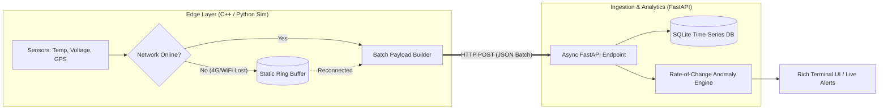

# ⚡ EdgePulse: Offline-First IoT Telemetry & Real-Time Anomaly Detection


**EdgePulse** is a fault-tolerant telemetry ingestion system and embedded firmware architecture designed for mission-critical monitoring (e.g., cold-chain logistics, fleet GPS tracking, and power supply diagnostics). 

Unlike basic IoT scripts that drop data during connectivity blackouts, EdgePulse implements a **deterministic static Ring Buffer in C++** on the edge node and an **asynchronous Batch-Sync ingestion engine in Python**, paired with derivative-based ($\frac{\Delta T}{\Delta t}$) anomaly detection.

---
## 🎥 Live Demo (Offline Ring-Buffer Sync & Thermal Spike Alert)


---
## 🏗️ System Architecture



---

## 🚀 Key Engineering Features

* **Zero-Heap-Fragmentation Ring Buffer (ESP32 / C++):** Implements a circular FIFO buffer using static memory allocation to guarantee zero data loss during 4G/Wi-Fi dropouts without risking microcontroller heap exhaustion.
* **Automatic Batch Synchronization:** Upon network recovery, the edge node flushes historical buffered packets alongside live telemetry in chunked payloads (`MAX_BATCH_SIZE`) until the queue is cleared.
* **Derivative Anomaly Detection ($\frac{\Delta T}{\Delta t}$):** Instead of relying solely on naive static thresholds, the backend tracks a sliding window per node to calculate the **Rate of Change (°C/min)**. It detects open refrigeration doors or cooling failures minutes before critical temperature limits are breached, alongside power-supply brownout detection (`LOW_VOLTAGE`).
* **Hardware-in-the-Loop Simulator (`simulator.py`):** No physical ESP32 required to evaluate the project. Includes a Rich-powered Terminal UI simulator that emulates sensor noise, network blackouts, ring-buffer queuing, batch recovery, and hardware faults out of the box.

---

## 📂 Repository Structure

```text
edgepulse/
├── .github/workflows/ci.yml   # Automated Pytest CI pipeline
├── firmware/esp32_node/       # C++ Firmware for ESP32 with static Ring Buffer
├── src/
│   ├── models.py              # Pydantic v2 strict data schemas
│   ├── detector.py            # Sliding-window ΔT/Δt & brownout anomaly engine
│   ├── server.py              # FastAPI asynchronous ingestion & SQLite storage
│   └── simulator.py           # Rich TUI Hardware & Network Blackout Simulator
├── tests/
│   └── test_detector.py       # Unit tests for anomaly detection logic
└── requirements.txt
```

---

## ⚡ Quick Start (Run in 30 Seconds)

You can test the entire pipeline—including simulated 4G dropouts, Ring Buffer batch syncing, and thermal spike alerts—directly on your machine without physical hardware.

### 1. Clone & Install Dependencies
```bash
git clone [https://github.com/YOUR_USERNAME/edgepulse.git](https://github.com/YOUR_USERNAME/edgepulse.git)
cd edgepulse
python3 -m venv venv
source venv/bin/activate
pip install -r requirements.txt
```

### 2. Run the Unit Tests
```bash
pytest -v
```

### 3. Start the Telemetry Backend (Terminal 1)
```bash
uvicorn src.server:app --reload
```

### 4. Launch the Hardware Simulator (Terminal 2)
```bash
python -m src.simulator
```

### Expected Simulator Output:
* **Packets #1–#3:** Normal `[ONLINE]` transmission (`~3.5°C`, `12.6V`).
* **Packets #4–#6:** Simulated `[OFFLINE - 4G LOST]` state. Packets are queued locally in the Ring Buffer.
* **Packet #7:** Network restored. Triggers `[BATCH SYNC]`, flushing all queued packets + live packet in a single HTTP transaction.
* **Packets #9–#12:** Simulated hardware fault triggers real-time `⚠ ALERT: THERMAL_SPIKE` and `LOW_VOLTAGE` warnings from the backend.

---

## 🔧 Flashing the ESP32 Firmware

1. Open `firmware/esp32_node/esp32_node.ino` in the **Arduino IDE** or **PlatformIO**.
2. Install the `ArduinoJson` library (v7.x).
3. Update `WIFI_SSID`, `WIFI_PASS`, and `SERVER_URL` with your local network credentials.
4. Flash to any ESP32 board and open the Serial Monitor at `115200 baud`.